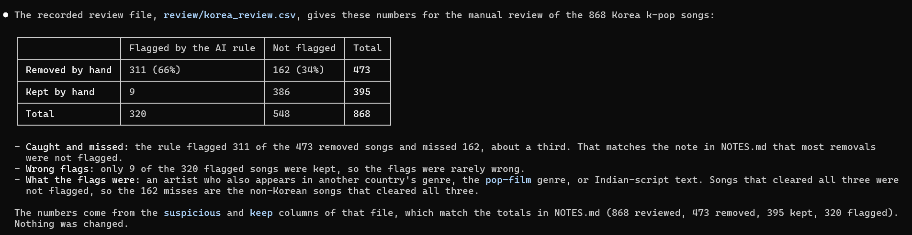
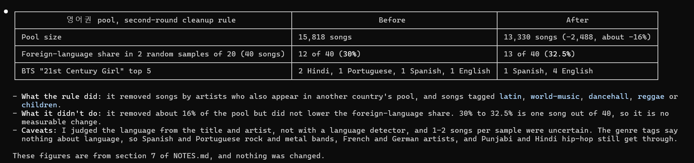
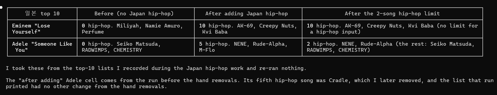
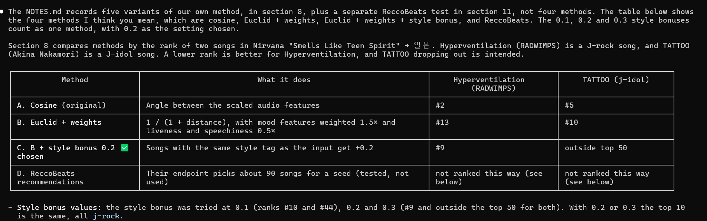
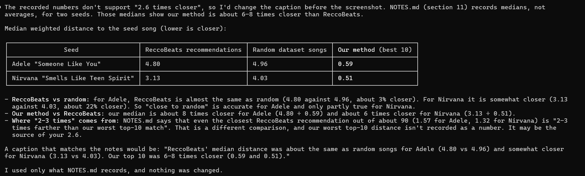
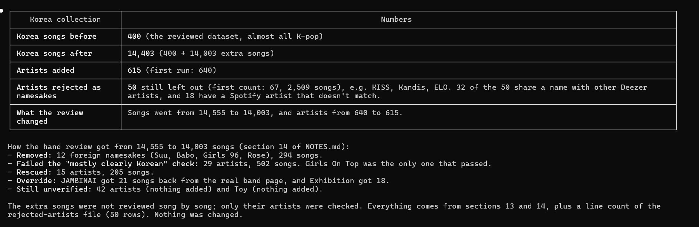

# Find Similar Songs

좋아하는 노래 하나로, 다른 나라의 비슷한 노래를 찾아 주는 웹앱이다.

**바로 써 보기:** https://findsimilarsongs.streamlit.app

## 1. 프로젝트 소개

나는 Måneskin의 Beggin' 같은 영미권 록을 좋아하는데, 비슷한 노래를 찾아주는 웹사이트나 비슷한 곡을 추천해주는 알고리즘에는 늘 영미권 팝·록만 나왔다. 같은 느낌의 일본 노래나 한국 노래도 찾고 싶었기에, **곡 하나와 나라를 고르면, 그 나라 음악 중에서 분위기가 비슷한 곡을 찾아 주는 앱**을 만들었다. 여러 나라 음악을 듣는 사람이 새 노래를 발견하도록 돕는 것이 목표다.

기존 음악 추천 시스템과는 이런 차별점이 있다.

- 밝기, 에너지, 템포 같은 분위기 수치를 직접 비교하고, 그 차이를 그래프로 보여 준다.
- 인기와 상관없이 분위기 수치로 고르기 때문에 덜 알려진 곡도 나온다.
- 같은 곡을 넣으면 항상 같은 결과가 나온다.

## 2. 사용 방법

1. 노래 제목이나 가수 이름을 입력하고, 나라를 고른다.
2. 검색된 목록에서 원하는 곡을 고른다.
3. 비슷한 곡 10곡이 나온다. 곡별 분위기 비교 그래프와 미리듣기 기능이 있으며, 재생 버튼은 Spotify를, 빨간 버튼은 YouTube를 연다.

검색은 정리된 데이터와 Deezer에서 함께 찾는다. 데이터에 없는 곡을 고르면 ReccoBeats에서 분위기 수치를 가져오고, 수치가 없는 곡은 슬라이더로 원하는 분위기를 직접 정할 수 있다.

## 3. 로컬에서 실행하기

```bash
git clone https://github.com/yejin07222/music.git
cd music
python -m venv .venv
source .venv/bin/activate
pip install -r requirements.txt
streamlit run app.py
```

정리된 데이터(`data/cleaned.csv`)와 추가로 모은 한국·일본 곡(`data/korea_extra.csv`, `data/japan_extra.csv`)이 저장소에 들어 있어서 원본 데이터 없이 실행된다. 정리 과정을 다시 돌리려면 Kaggle의 [Spotify Tracks Dataset](https://www.kaggle.com/datasets/maharshipandya/-spotify-tracks-dataset)을 `data/dataset.csv`로 받은 뒤 `python clean_data.py`를 실행한다.

## 4. 작업 과정

주제별로 정리했다. 실제로는 추천 결과를 확인하고 문제가 발견되면 데이터를 고치고 다시 확인하는 과정을 반복했다.

1\. **계획:** Claude Code에 바로 코드를 시키지 않고, 데이터 구조를 먼저 확인한 뒤 단계별 계획부터 세웠다. 한 단계가 끝날 때마다 결과를 직접 확인하고 커밋했다.

2\. **데이터 전처리:**

- Kaggle의 Spotify 데이터 114,000곡에서 중복과 이상한 값을 지워 81,061곡을 남겼다. 데이터에 나라 정보가 없어서 장르(k-pop, j-rock 등)로 나라를 추정했다.
- 장르 추정으로는 나라를 완벽하게 분류하기 어려워 한국, 일본, 영어권의 곡은 직접 검토했다.

* 데이터 전처리 후 한국 곡이 400곡밖에 남지 않았고, 거의 다 k-pop이었다. 그래서 출신 나라가 기록된 MusicBrainz에서 한국 가수를 찾아 14,003곡을 추가했다.
* 일본 곡에는 힙합 장르가 없어 따로 일본 힙합 3,799곡을 추가했다.

3\. **추천 방식:** 분위기 수치 9개(밝기, 에너지, 댄스, 어쿠스틱, 템포, 음량, 말소리 비율, 연주곡 정도, 라이브 느낌)를 표준화하고, 수치가 가장 가까운 곡을 찾는다. 추천 곡을 직접 들어보고 가중치를 아래처럼 조정했다.

- 밝기, 에너지, 어쿠스틱, 댄스, 템포: 가중치 1.5배
- 라이브 느낌, 말소리 비율: 가중치 0.5배
- 입력 곡과 같은 장르 계열일 경우: 점수 +0.2

4\. **외부 데이터 활용:** Spotify의 분위기 수치 API가 막혀 있어서, Deezer로 곡을 찾고 ReccoBeats로 같은 기준의 수치를 받게 했다.

5\. **검색 개선:** Spotify 데이터에 없는 곡은 검색이 잘 안되는 문제를 발견해서, 검색할 때 항상 Deezer에서도 함께 찾게 했다.

6\. **화면과 배포:** 디자인 시안을 여러 번 비교해 화면을 다듬고, PC와 휴대폰 화면에 맞게 배치가 바뀌게 만든 뒤 Streamlit Community Cloud에 배포했다.

## 5. Claude Code 사용 증거

아래 6장은 Claude Code와 작업한 기록 중 일부다.

**1. AI 규칙이 못 잡은 곡:** 한국 곡 868곡을 직접 검토해 473곡을 뺐다. 이 중 162곡은 AI 규칙이 잡지 못한 곡이었다.



**2. 효과 없는 규칙:** 영어권에서 외국어 곡을 거르는 규칙을 적용했지만, 외국어 곡 비율은 30%에서 32.5%로 그대로였다. 그래서 가수 목록을 직접 분류했다.



**3. 비어 있던 장르 보충:** 일본 곡에 힙합이 없어서 Eminem을 넣어도 J-pop만 나왔다. 일본 힙합을 추가하자 랩이 나왔지만 Adele에도 랩이 섞여서, 힙합이 아닌 곡에는 힙합을 2곡까지만 넣었다.



**4. 추천 방식 비교:** Nirvana의 Smells Like Teen Spirit을 넣고 일본 곡을 추천받아, 처음 방식, 가중치만 준 방식, 장르계열 점수까지 더한 방식을 비교했다. 장르계열 점수 0.2를 더하자 상위 10곡이 모두 J-rock이 됐다.



**5. 외부 추천과 비교:** ReccoBeats 추천 곡은 무작위 곡과 큰 차이가 없었고, 우리 방식이 6\~8배 더 가까웠다.



**6. 부족한 데이터 보충:** MusicBrainz로 한국 가수를 찾아 한국 곡을 400곡에서 14,403곡으로 늘렸다.



## 6. 검증 결과

- **Nirvana의 Smells Like Teen Spirit → 한국:** 한국 곡 보충 전에는 BTS 등 k-pop이 나왔고, 보충 후에는 신해철, 서태지 같은 한국 록이 나왔다.
- **Eminem의 Lose Yourself → 일본:** 일본 힙합 보충 전에는 J-pop, 아이돌 곡만 나왔고, 보충 후에는 10곡 모두 일본 랩이 나왔다.
- **입력에 따라 결과가 달라지는지:** Nirvana와 Dust in the Wind를 일본으로 넣었을 때 겹치는 곡은 0곡이었다.
- **자동 테스트:** 나라 필터, 추천 계산, 검색 등이 제대로 되는지 확인하는 테스트 181개가 모두 통과한다.
- **엣지 케이스:** 데이터에 없는 곡, 분위기 정보가 없는 최신 곡, 외부 서비스가 멈춘 경우에도 앱은 멈추지 않고 슬라이더로 넘어간다.

## 7. 잘 통했던 방법 3가지

AI가 만든 결과를 그대로 쓰면 틀린 경우가 많아서, AI에게 맡기는 방식을 상황마다 다르게 했다.

### 1. AI 규칙을 믿지 않고 직접 확인했다.

Claude Code가 만든 규칙으로는 k-pop에 섞인 인도 곡도, 영어권에 섞인 외국어 곡도 제대로 걸러지지 않았다. 그래서 AI에게 수천 곡을 표로 정리해 의심 가는 것부터 보여 달라고 하고, 곡을 거르는 작업을 직접 했다. 한국 곡 보충 때도 AI가 모은 가수 목록을 내가 다시 확인해서 외국 가수를 뺐다.

### 2. 새 기능은 바로 만들지 않고 짧게 시험부터 했다.

될지 안 될지 모르는 기능은 앱에 바로 넣지 않고, 먼저 시험만 했다. 시험해 보니 안 되는 경우가 많았다.

- Spotify 검색: 무료 계정으로는 쓸 수 없었다.
- ReccoBeats 추천: 무작위로 고른 곡과 비슷한 수준이었다.

앱을 망가뜨리거나 시간을 버리기 전에 이걸 알 수 있었고, 한국 곡 보충처럼 효과가 있는 것만 골라 넣었다.

### 3. 같은 곡으로 매번 전후를 비교했다.

기준 곡 몇 개를 정해 두고, 데이터나 추천 방식을 바꿀 때마다 같은 곡으로 다시 추천을 받아 바뀌기 전과 후를 나란히 비교했다.

- Adele의 Someone Like You → 한국: 인도 곡 4곡 → 0곡

기능이 나아졌다는 것을 숫자로 확인할 수 있었다. 일본 힙합을 추가했을 때 Adele 결과에 랩이 섞인 문제도 이 비교로 찾았다.

## 8. 어려웠던 점 3가지

### 1. 장르 태그가 나라와 맞지 않았다.

데이터에 나라 정보가 없어서 장르로 나라를 추정했는데, 잘 맞지 않았다. k-pop 868곡 중 473곡이 인도 노래 등 외국 곡이었다. 결국 한국, 일본과 영어권은 직접 분류해 걸러 냈다.

**남은 문제:** 인도, 중국, 튀르키예 등 다른 나라는 아직 검토하지 못했다.

### 2. 추천 곡이 실제로 들어 보니 비슷하지 않았다.

수치로는 가까운데 들어 보면 느낌이 달랐다. 그래서 가중치와 장르 점수를 추가했다.

그런데 한국 곡은 대부분 k-pop만 있어서 효과가 없었다. 장르 정보가 있는 한국 곡을 추가한 뒤에야 Nirvana를 넣으면 BTS 대신 신해철, 서태지 같은 한국 록이 나왔다.

**남은 문제:** 수치로는 목소리나 악기 소리를 비교할 수 없어서, 여전히 들어 보면 다르게 느껴지는 곡이 있다.

### 3. 외부 API가 막혔다.

Spotify가 분위기 수치 API를 막았고, 검색 API에도 Premium 계정이 필요해졌다. 그래서 무료인 Deezer로 곡을 찾고 ReccoBeats로 수치를 받았다.

**남은 문제:** 둘 다 비공식 무료 서비스라 언제든 멈출 수 있고, 최신 곡은 수치가 없다.

## 9. 알려진 한계

- 나라는 장르로 추정했고, 한국·일본·영어권만 직접 검토했다.
- 분위기 수치로는 목소리, 악기 소리, 언어 같은 느낌을 잡지 못한다.
- 추천 결과에는 데이터 안의 곡만 나온다.
- 최신 곡은 분위기 수치가 없는 경우가 많아, 검색해도 슬라이더로 넘어간다.
- 한국 곡도 제목과 가수 이름이 영어로 나오는 경우가 많고, 한글 검색은 일부 가수만 된다.
- Deezer와 ReccoBeats는 비공식 무료 서비스라, 멈추면 데이터에 없는 곡은 검색할 수 없다.

## 10. 핵심 파일

| 파일 | 역할 |
| --- | --- |
| `recommender.py` | 분위기 수치를 비교해 비슷한 곡을 찾는 추천 로직 (가중치, 장르계열 점수, 힙합 제한) |
| `app.py` | Streamlit 웹 화면 |
| `countries.py` | 장르를 나라로 묶는 표 |
| `online_lookup.py` | Deezer 검색과 ReccoBeats 분위기 수치 가져오기 |
| `scripts/collect_korea_extra.py` | MusicBrainz로 한국·일본 곡을 모으고 이름이 같은 외국 가수를 거르는 스크립트 |
